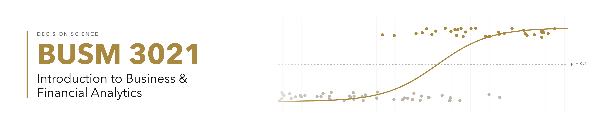

# BUSM 3021: Business & Financial Analytics II

| | |
| :--- | :--- |
| **Instructor** | Brett Vanderblock |
| **Email** | [brett.block@colorado.edu](mailto:brett.block@colorado.edu) |
| **Lecture** | TTH 12:30p - 1:45p, KOBL 127 |
| **Course Site** | canvas.colorado.edu |
| **TA** | Emily Sefton ([Emily.Sefton@colorado.edu](mailto:Emily.Sefton@colorado.edu)) |
| **Zoom** | <https://cuboulder.zoom.us/j/5459996921> |

## About BUSM 3021

**Course Focus:** this course translates your business statistics foundations
into applied, real-world analytics and decision science. You will gain hands-on
tools of the trade, including Python (via Google Colab), logistic regression,
decision trees, Monte Carlo simulation, and linear programming, to support
better business decisions.

**Prerequisites:** Requires corequisite of BUSM 3020. Restricted to students
pursuing Business Minor (BUSM-MIN).

## Our Learning Goals

After successfully completing this course, you will:

1. Translate what you've learned to real-world analytics work.
2. Learn decision-making frameworks to navigate risk.
3. Understand advanced classification techniques and the fundamentals of data
   mining.
4. Leverage linear programming in guiding business decisions.
5. Make better, more informed decisions.

## Required Course Materials (No Purchases Necessary)

This course has **no required textbook**. You will need the following:

### → A laptop with Excel 2019 or newer

In this course we'll be applying our analytics learnings directly through
Microsoft Excel, so have your computer with Excel available for each lesson.
This class is **phone-free**: please keep your phone put away during class, and
only open your laptop when instructed to do so.

Microsoft Online is available free here:
<https://portal.office.com/OLS/MySoftware.aspx>.

### → Google Colab (Python)

In your Chrome browser, go to <https://colab.new>. We use Python through Google
Colab for parts of this course. **No coding experience is required.**

### → ChatGPT Edu account

CU Boulder provides ChatGPT Edu to all students at no cost. A ChatGPT Edu account
is **required for the course project**. See the Use of AI section for how GenAI
is used in this course.

## Assignments and Grading

In this course, your grade consists of **participation (10%)**, **homework
including a project (50%)**, and **two exams (midterm 20% and final 20%)**.

All graded items and final course grades are considered final one week after
being made available to students, unless otherwise stated. Please **check Canvas
for posted grades**.

The college target is a **3.0 (B) average**. Final course grades may be curved
up toward that target, but never down, in accordance with the Leeds Grading
Guidelines.

### Participation & Attendance (10%)

Working in Business Analytics is a practice in applying theoretical concepts and
adopting a "Learn by Doing" approach. To reinforce this, a portion of your grade
is based on participation: for each class, complete the **daily Canvas quiz** (a
password is provided in class).

### Homework and Project (50%)

Homework is assigned through **Canvas** and is generally due the following
**Monday at midnight**. Assignments come in two formats: a **quiz format in
Canvas** (up to 3 attempts) and submissions where you **upload your work**
through Canvas. Submissions will not be allowed once the deadline has passed.

One **special project** is included and counts for 20% of your homework grade
(10% of your overall grade); it is **due Tuesday, December 1** and requires a
ChatGPT Edu account. See the course schedule for details.

### Exams: Midterm and Final (40%)

There are two exams, a **midterm (20%)** on **Tuesday, November 3** and a
**final (20%)** on **Thursday, December 3**, both taken **in class** on your
computer through Canvas (use Chrome). They combine multiple choice, true/false,
and open-response questions, and are **open-book and open-note**, using Excel and
Google Colab. The **final is not comprehensive**; it covers the second half of
the course. Practice exams are provided in advance. Discuss any exam conflicts by
the **end of the second week of class**.

> **Note:** It is considered a violation of the Honor Code to copy or otherwise
> record any exam/quiz questions for the aid of others. Further, any and all
> outside assistance (e.g. via email, texting, etc.) during an exam is
> considered cheating. As such, we will be using Proctorio proctoring software
> during all exams and quizzes.

## Use of AI

CU Boulder provides **ChatGPT Edu** to students, and a ChatGPT Edu account is
**required for the course project**. In this course you may use GenAI as a
**coding and analytics aid**: for example, to help you understand Python, debug a
Colab notebook, or explore approaches to a problem. You remain responsible for
the correctness and integrity of anything you submit. Using any AI tool during
the midterm or final is prohibited and treated as an Honor Code violation.

## Additional Policies

### Excused Absences / Assignment Extensions

Once you are aware of a situation about which you would like to be considered for
an excused absence or assignment extension, please immediately send an email to
the instructor. Subject to applicable laws and University of Colorado
regulations, any grant of special treatment is at the sole discretion of the
instructor. Situations that may justify special treatment:

- A medical or emergency situation for which the Office of the Dean of Students
  has provided written notice to the instructor
- An absence due to a temporary medical condition or a documented disability
- Religious observations for which the student has notified the instructor well
  in advance of the conflict
- School-sanctioned travel with appropriate and timely documentation

Instructors are not obligated to accommodate any potential conflicts, but may, at
their own discretion, allow reasonable accommodations for these absences. Please
check the course calendar and final exam schedule before making any travel
arrangements; travel arrangements generally do not excuse missed exams or other
missed assignments. Absences due to illness must be communicated via email to the
instructor the day of the absence, before any clicker or other participation
grades are recorded in Canvas, or sooner in order to be considered for excusal.

### Unexpected Class Cancellations

Should class be cancelled for any reason (e.g. weather, building evacuations,
etc.), you are responsible for following instructions related to missed content.
Class may be held online during our regular class period, recorded, and/or
additional materials may be provided covering the missed content.

### Honor Code

All students enrolled in a University of Colorado Boulder course are responsible
for knowing and adhering to the academic integrity policy of the institution.
Violations of the policy may include: plagiarism, cheating, fabrication, lying,
bribery, threat, unauthorized access, clicker fraud, resubmission, and aiding
academic dishonesty. All incidents of academic misconduct will be reported to the
Honor Code Council (honor@colorado.edu; 303-735-2273). Students who are found
responsible for violating the academic integrity policy will be subject to
nonacademic sanctions from the Honor Code Council as well as academic sanctions
from the faculty member. Additional information regarding the academic integrity
policy can be found at <http://honorcode.colorado.edu>. (Statement from Vice
Provost Mary Kraus' recommended syllabus statements, December 2016.)

### Disability Services

If you qualify for accommodations because of a disability, please submit to your
professor a letter from Disability Services in a timely manner (for exam
accommodations provide your letter at least two weeks prior to the exam) so that
your needs can be addressed. Disability Services determines accommodations based
on documented disabilities. Contact Disability Services at 303-492-8671 or by
email at dsinfo@colorado.edu. If you have a temporary medical condition or injury,
see Temporary Injuries guidelines under the Quick Links at the Disability Services
website and discuss your needs with your professor. (Statement based on The
Boulder Provost's Disability Task Force recommended syllabus statement, sent by
Vice Provost Mary Krause, December 2016.)

### Classroom Behavior

Students and faculty each have responsibility for maintaining an appropriate
learning environment. Those who fail to adhere to such behavioral standards may be
subject to discipline. Professional courtesy and sensitivity are especially
important with respect to individuals and topics dealing with differences of
race, color, culture, religion, creed, politics, veteran's status, sexual
orientation, gender, gender identity and gender expression, age, disability, and
nationalities. Class rosters are provided to the instructor with the student's
legal name. I will gladly honor your request to address you by an alternate name
or gender pronoun. Please advise me of this preference early in the semester so
that I may make appropriate changes to my records. For more information, see the
policies on classroom behavior and the student code. (Statement from Vice Provost
Mary Kraus' recommended syllabus statements, December 2016.)
